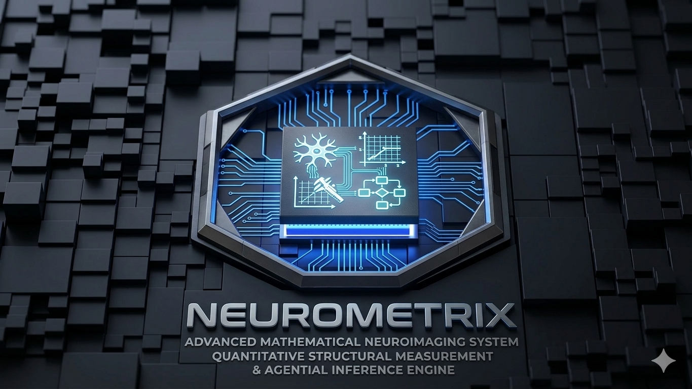



  
  
  <h1>NEUROMETRIX</h1>
  
  <b>ADVANCED MATHEMATICAL NEUROIMAGING SYSTEM</b> 
  <i>QUANTITATIVE STRUCTURAL MEASUREMENT & AGENTIAL INFERENCE ENGINE</i>  

  
  
  
  
    
  

---

## 📖 Project Overview
This repository is part of the **Neurometrix** microservices architecture, built for the **AMD Developer Hackathon ACT III**.

Neurometrix is a high-performance clinical AI assistant designed to automate 4D perfusion imaging analysis. By combining a low-latency C++ mathematical core with a swarm of LLM agents (accelerated on AMD ROCm using Google's Gemma), Neurometrix extracts critical hemodynamic metrics and generates expert-level radiological reports with **zero hallucinations**, keeping the human physician in the loop.

## 🏗️ Architecture Components
1. **Agents (This Repo)**: Python AI Swarm, ETL, and Streamlit Frontend.
2. **Core 4D**: High-performance C++ engine for 4D perfusion processing.
3. **Core 3D/2D**: Specialized C++ engines for other imaging dimensions.
4. **Router**: C++ Intelligent Router (Hexagonal Architecture).

## 🚀 Quick Start
Please refer to the USER_MANUAL.md and CLINICAL_USER_MANUAL.md files in this repository for deployment and usage instructions.
